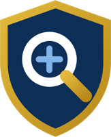
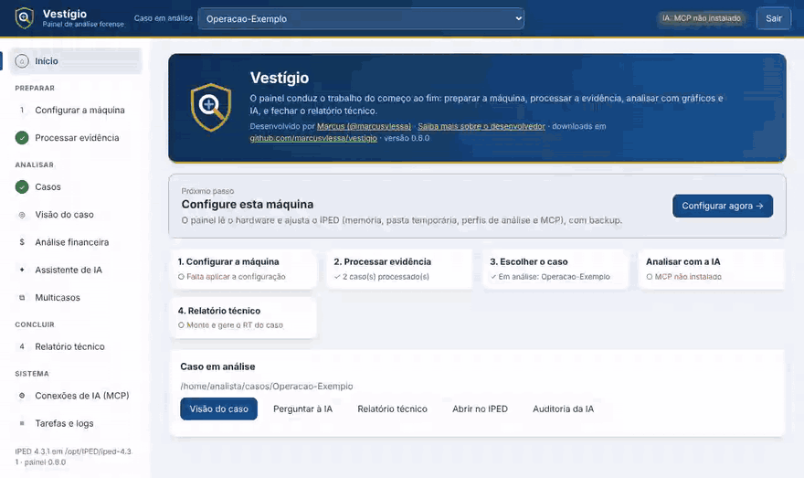
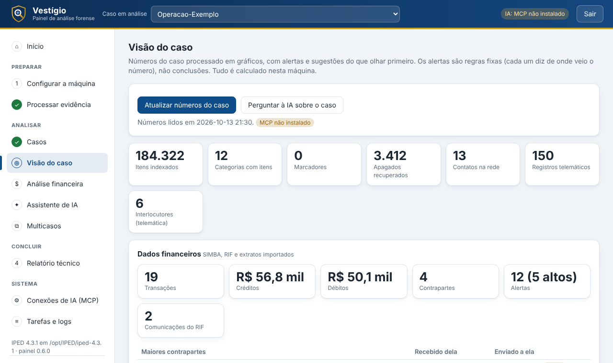
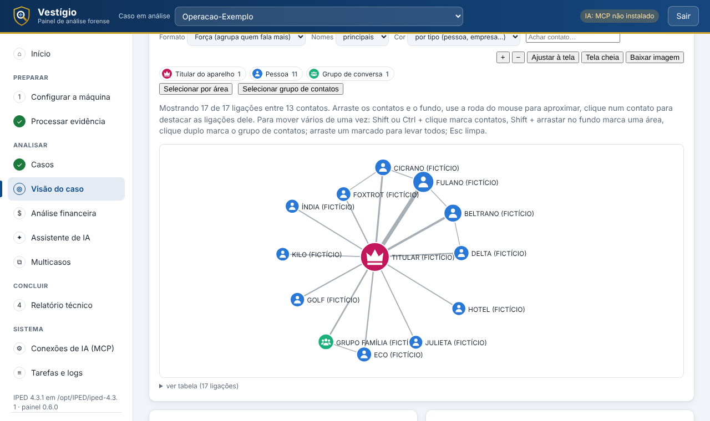
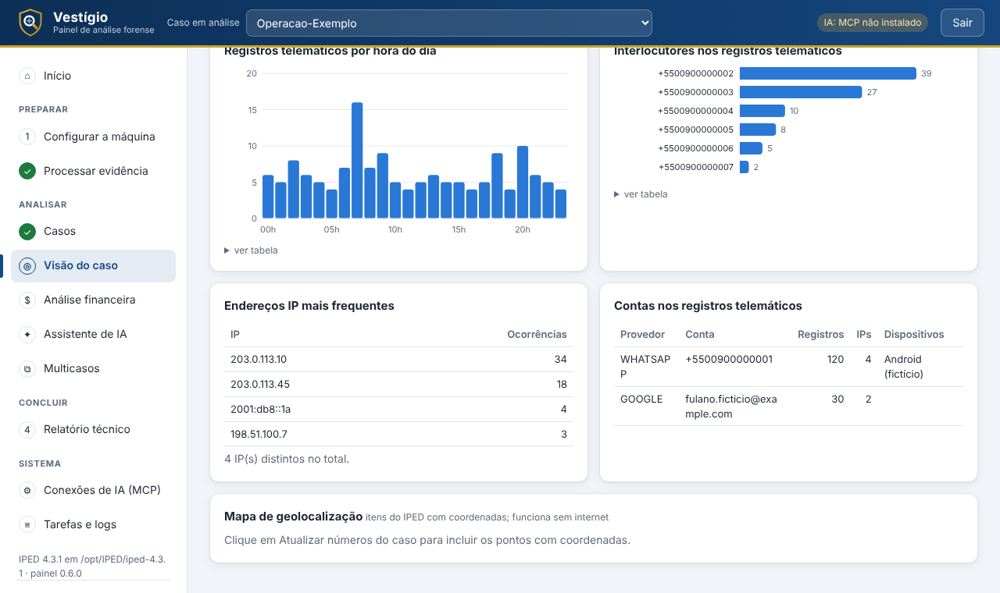
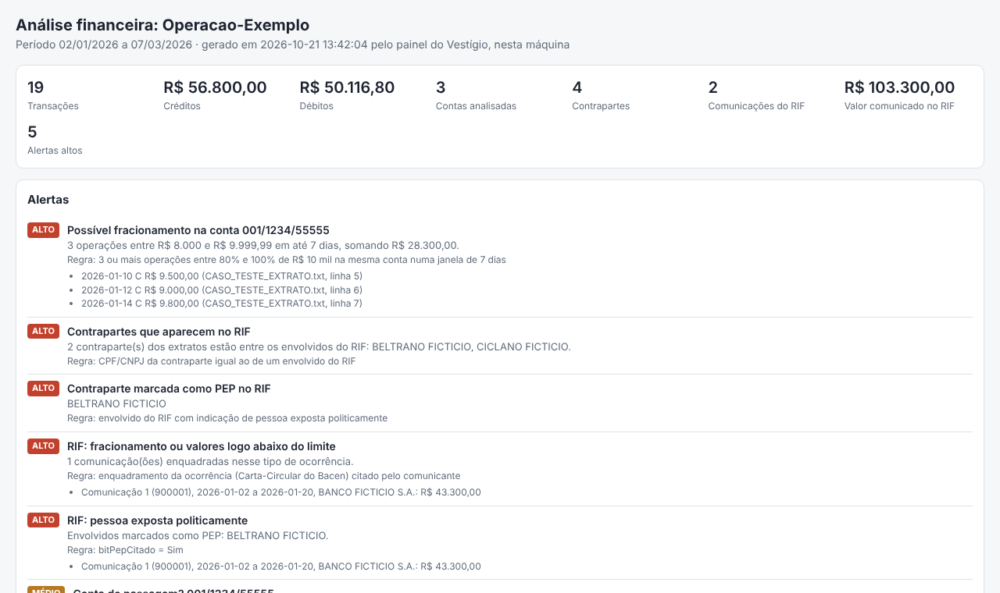
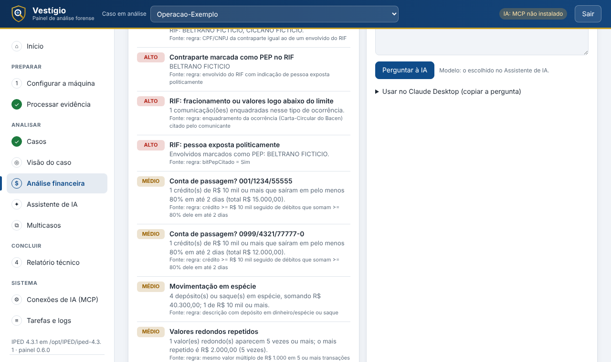
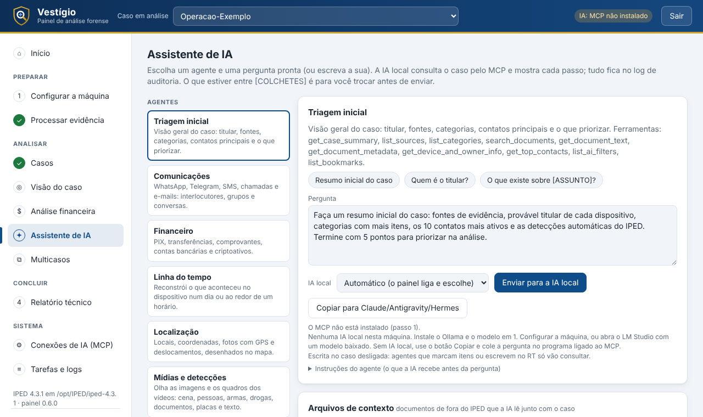
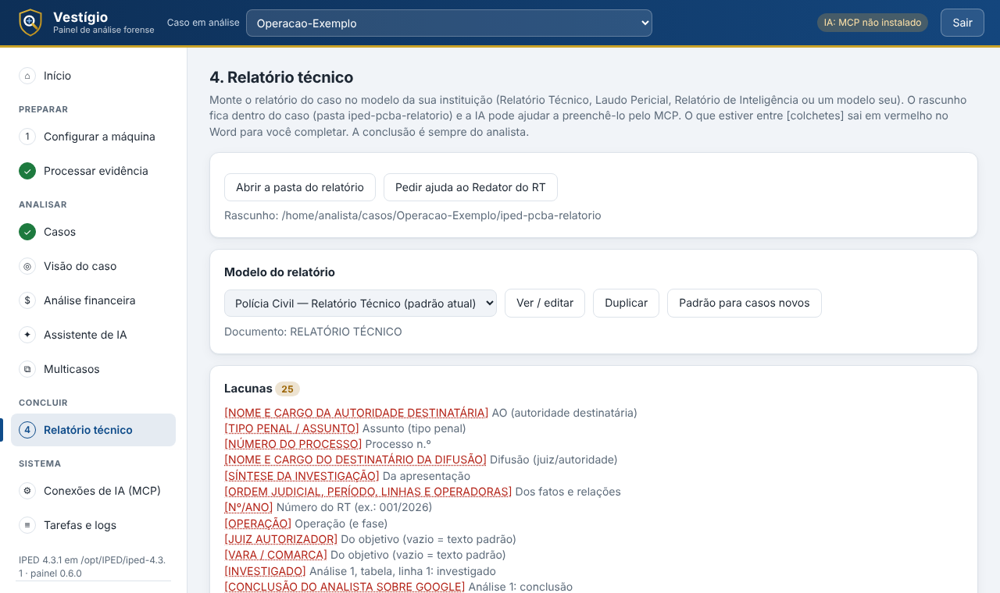
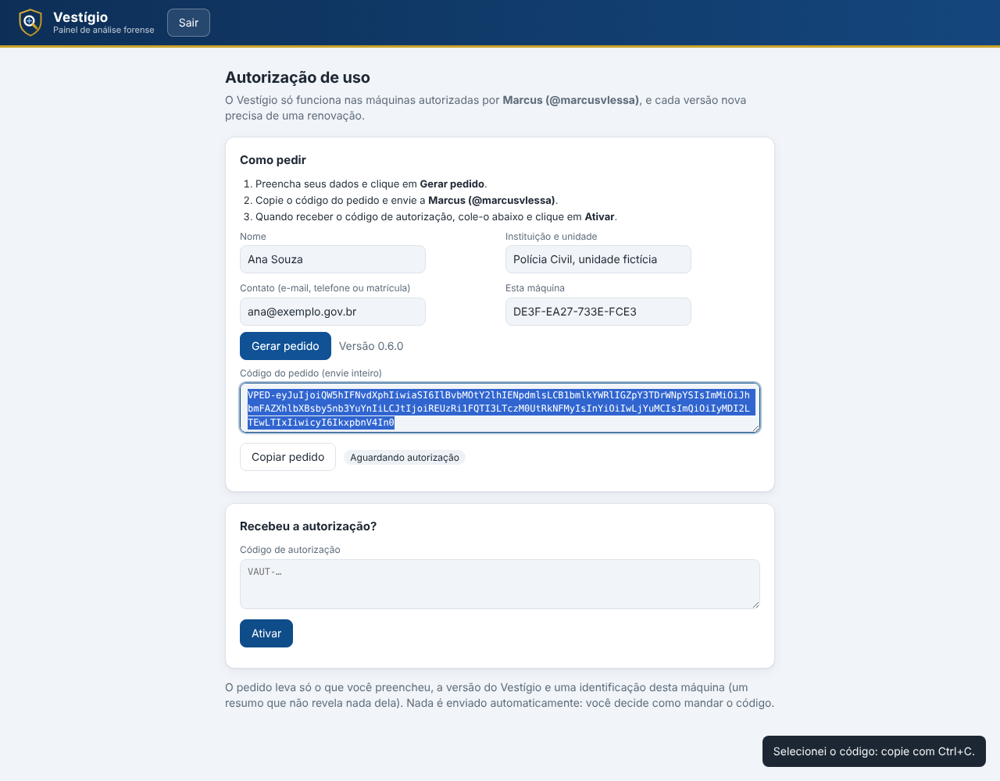

  
  <h1>Vestígio</h1>
  
<strong>Assistente de análise forense para o IPED: instala, configura, analisa com IA local auditada e entrega o relatório no modelo da sua instituição.</strong>

  

    <a href="https://github.com/marcusvlessa/vestigio/releases/latest">Baixar</a> ·
    <a href="#instalar">Instalar</a> ·
    <a href="#o-que-ele-faz">O que ele faz</a> ·
    <a href="#autorização-de-uso">Autorização de uso</a> ·
    <a href="#desenvolvedor">Desenvolvedor</a>
  

  

    
    
    
    
  

Todos os dados das telas são fictícios.

## Do vestígio ao relatório

| Preparar | Analisar | Concluir |
| :--- | :--- | :--- |
| Instala e configura o IPED sozinho, com backup | Visão do caso, rede de vínculos e telemática | Relatório no modelo da instituição (.docx) |
| Processa evidências em fila, com progresso ao vivo | Análise financeira (SIMBA, RIF, extratos) | IA local com log de auditoria por caso |

<strong>Ver as telas</strong> · visão do caso, rede, financeiro, assistente, relatório e autorização

<table>
  <tr>
    <td></td>
    <td></td>
  </tr>
  <tr><td align="center">Visão do caso</td><td align="center">Rede de vínculos</td></tr>
  <tr>
    <td></td>
    <td></td>
  </tr>
  <tr><td align="center">Registros telemáticos</td><td align="center">Dashboard financeiro (funciona sem internet)</td></tr>
  <tr>
    <td></td>
    <td></td>
  </tr>
  <tr><td align="center">Análise financeira</td><td align="center">Assistente de IA</td></tr>
  <tr>
    <td></td>
    <td></td>
  </tr>
  <tr><td align="center">Relatório técnico</td><td align="center">Autorização de uso</td></tr>
</table>

## O que ele faz

O Vestígio é um painel que acompanha o analista do começo ao fim de um caso no [IPED](https://github.com/sepinf-inc/IPED). Serve a qualquer instituição de segurança: polícias, perícias, núcleos de inteligência e Ministério Público.

- **Instala e configura o IPED sozinho.** Descobre o que a máquina tem e instala o que falta (IPED, transcrição de áudio, reconhecimento facial, IA local). Guarda uma cópia da configuração antes de mudar qualquer coisa.
- **Processa as evidências em fila**, com o progresso na tela, e escolhe o perfil certo para celular, computador ou retorno de provedor.
- **Mostra o caso de forma visual:** visão geral com alertas, rede de vínculos, linha do tempo, mapa de localizações e registros telemáticos.
- **Faz a análise financeira** de SIMBA, RIF e extratos, com alertas e um painel que funciona sem internet.
- **Traz um assistente de IA local** que consulta o caso, descreve imagens e vídeos e refaz transcrições de baixa qualidade. Cada consulta fica registrada no log de auditoria do caso.
- **Gera o relatório** no modelo da sua instituição, em .docx.

Os dados do caso ficam na sua máquina. A IA local é o padrão. Ligar uma IA na nuvem é opcional, e o painel avisa antes.

## Instalar

1. Baixe o pacote da [versão mais nova](https://github.com/marcusvlessa/vestigio/releases/latest):
   - **Windows:** `iped-pcba-windows.zip`. Descompacte em qualquer pasta e dê dois cliques em `Vestigio.exe`.
   - **Linux (servidor):** `iped-pcba-linux.tar.gz`. Descompacte e rode `scripts/instalar.sh`.
2. Na primeira vez, peça a autorização de uso (veja abaixo).
3. Siga os passos do painel. Ele mostra o que falta na máquina e instala com um clique.

Não é preciso instalar Python nem o IPED antes. Se a máquina não tiver o IPED, o Vestígio oferece baixar a versão oficial.

## Autorização de uso

O Vestígio só funciona em máquinas autorizadas, e cada versão nova precisa de uma renovação.

1. Na primeira vez, o painel abre na tela **Autorização de uso**. Preencha nome, instituição e contato e clique em **Gerar pedido**.
2. Envie o código do pedido ao [desenvolvedor](#desenvolvedor).
3. Cole o código de autorização que receber e clique em **Ativar**.

Quando sai uma versão nova, o painel continua funcionando na atual e mostra **Gerar pedido de renovação**. A nova versão é instalada depois que a renovação é ativada.

## Atualizações

O painel procura versões novas sozinho e baixa em segundo plano. A versão anterior fica guardada numa pasta ao lado, caso seja preciso voltar.

## Desenvolvedor

Marcus ([@marcusvlessa](https://github.com/marcusvlessa)) · [Saiba mais sobre o desenvolvedor](https://www.linkedin.com/in/marcuslessa-ia/)
